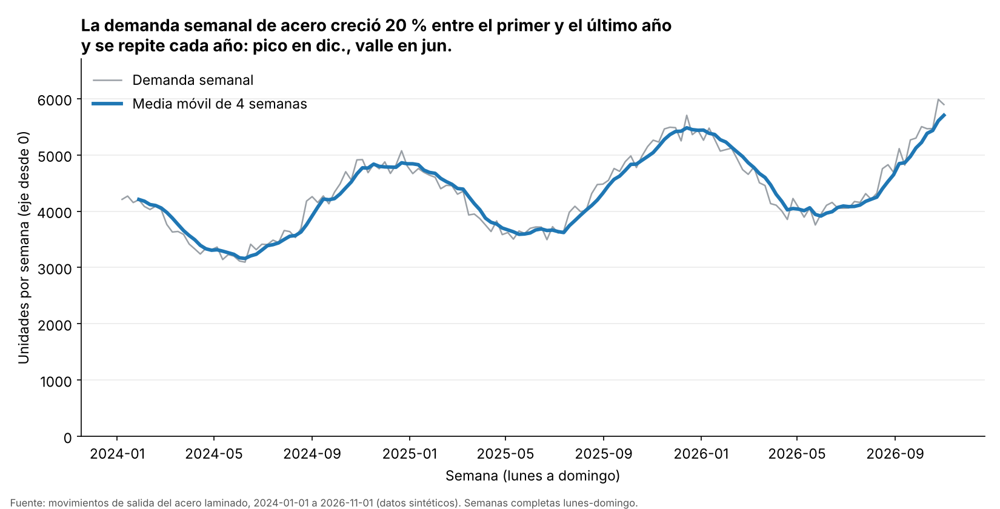
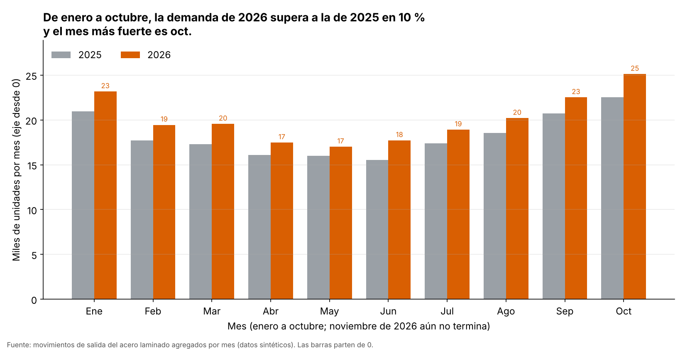

<!--
CONFIG
FULL_NAME: Juan Pablo Ortega Vargas
GITHUB_USER: Ju4n-0rtega
-->

# Actividad Calificable · Corte 3 — Análisis temporal y visualización

**Repositorio GitHub:** https://github.com/Ju4n-0rtega/electiva-vi-ciencia-datos-2026-b-g1/tree/main/14-week/actividad-c3

**Curso:** Electiva VI · Ciencia de Datos · Corte 3 (semana 14)
**Caso:** demanda de una materia prima (acero laminado) en una planta industrial, continuación del caso de logística e inventarios.

**Pregunta de datos:** ¿cómo ha evolucionado la demanda de acero, tiene tendencia y estacionalidad, y cómo hacer que consultarla sea rápido?

## Datos

La serie sale de **345.003 movimientos de inventario** (salidas y entradas) entre el 1 de enero de 2024 y el 1 de noviembre de 2026. Son datos **sintéticos**, generados con semilla fija en `analisis_temporal.py`, así que cualquiera puede reproducirlos. La demanda son las **salidas** (las entradas son reposiciones y no cuentan). Con SQL se agregan por día y se obtiene la serie diaria de 1.036 días, que equivale a 148 semanas completas de lunes a domingo.

## 1. Serie temporal: `resample` y media móvil

```python
serie = pd.read_sql_query("""
    SELECT fecha, SUM(cantidad) AS unidades
    FROM movimientos WHERE tipo = 'salida'
    GROUP BY fecha ORDER BY fecha""", con, parse_dates=["fecha"]).set_index("fecha")["unidades"]

semanal = serie.resample("W-SUN").sum()         # agregar por semana (lunes a domingo)
media_movil = semanal.rolling(window=4).mean()  # media móvil de 4 semanas
mensual = serie.resample("MS").sum()            # agregar por mes
```

- **Por qué semanas y no días:** la demanda diaria cambia mucho entre semana y fin de semana; al sumar por semana ese ruido desaparece y se ve la forma de fondo.
- **Por qué una media móvil de 4 semanas:** promedia cada semana con las 3 anteriores (aproximadamente un mes) y suaviza las variaciones casuales sin esconder los cambios grandes. Las tres primeras semanas quedan sin valor porque aún no hay 4 semanas para promediar.

**Tendencia.** Es creciente. La demanda semanal promedio pasó de **3.960 unidades** en el primer año a **4.760** en el último, un aumento de **20.2 %**. La recta de tendencia sube unas **8.43 unidades por semana, cada semana**.

**Estacionalidad.**
- *Anual:* se repite cada año. El mes más alto es **dic.** (índice 1.23, o sea 23 % sobre el promedio del año) y el más bajo es **jun.** (índice 0.81, 19 % bajo el promedio). Se calculó solo con 2024 y 2025, que son años completos, y dividiendo cada mes por el promedio de su propio año para que el crecimiento no se confunda con la estacionalidad.
- *Semanal:* el sábado la demanda es el **57 %** de un día entre semana y el domingo solo el **28 %** (lunes 763, martes 757, miércoles 733, jueves 734, viernes 701, sábado 420, domingo 208 unidades por día en promedio).

## 2. Dos visualizaciones

### Evolución: línea semanal con media móvil



### Comparación: barras por mes, 2025 contra 2026



**Principios aplicados (y por qué son honestos):**
- *Gráfico adecuado a la pregunta:* una línea para ver cómo cambia algo en el tiempo; barras agrupadas para comparar el mismo mes entre dos años. Un solo gráfico no sirve para las dos cosas.
- *Título que expresa la conclusión,* no solo el tema ("Demanda de acero"). Quien lo lea entiende el mensaje sin buscarlo.
- *Ejes honestos:* los dos ejes verticales **parten de 0** y dicen la unidad ("unidades por semana", "miles de unidades por mes"). Con las barras, cortar el eje exagera las diferencias, por eso no se corta.
- *Solo periodos completos:* se usan semanas completas y se excluye noviembre de 2026 porque solo tiene 1 día. Comparar un mes incompleto contra uno completo daría una caída falsa.
- *Se muestran los datos reales junto al suavizado,* y la fuente va al pie, con la aclaración de que son datos sintéticos.
- *Simple:* sin 3D, sin decoración, solo dos colores con buen contraste, y etiquetas de valor únicamente donde ayudan a leer.

## 3. Optimización de una consulta SQL

**Necesidad:** la demanda diaria de un mes (marzo de 2026) sobre la tabla de 345.003 filas.

```sql
-- A) Original: función sobre la columna y sin índice
SELECT fecha, SUM(cantidad) AS unidades
FROM movimientos
WHERE tipo = 'salida' AND strftime('%Y-%m', fecha) = '2026-03'
GROUP BY fecha ORDER BY fecha;

-- B) Filtro por rango (misma respuesta, sin función sobre la columna)
SELECT fecha, SUM(cantidad) AS unidades
FROM movimientos
WHERE tipo = 'salida' AND fecha >= '2026-03-01' AND fecha < '2026-04-01'
GROUP BY fecha ORDER BY fecha;

-- C) Igual que B, más un índice compuesto
CREATE INDEX idx_mov_tipo_fecha ON movimientos(tipo, fecha);
```

| Versión | Plan de ejecución (`EXPLAIN QUERY PLAN`) | Tiempo mediano* |
|---|---|---|
| A · Original | `SCAN movimientos` (lee toda la tabla) | 89.69 ms |
| B · Rango sin índice | `SCAN movimientos` (todavía lee toda la tabla) | 26.66 ms |
| C · Rango + índice | `SEARCH movimientos USING INDEX idx_mov_tipo_fecha (tipo=? AND fecha>? AND fecha<?)` | **1.5 ms** |

\*Mediana de 15 ejecuciones en mi equipo; los milisegundos cambian según la máquina, pero la proporción se mantiene. Las tres versiones devuelven exactamente el mismo resultado (31 filas, una por día de marzo); el script lo comprueba con un `assert`.

**Por qué mejora:**
1. *De A a B (aproximadamente 3.4 veces más rápida):* en A, SQLite tiene que calcular `strftime` para cada una de las 345.003 filas antes de comparar. Al comparar `fecha` directamente contra un rango, el cálculo por fila desaparece y la condición queda en una forma que un índice puede usar.
2. *De B a C (aproximadamente 17.8 veces más rápida):* el índice `(tipo, fecha)` está ordenado primero por tipo y luego por fecha, así que SQLite va directo a las salidas de marzo (`SEARCH`) en lugar de revisar toda la tabla (`SCAN`).
3. **Métrica de mejora:** tiempo mediano de ejecución, de 89.69 ms a 1.5 ms, es decir, **60.0 veces más rápida**. Como contrapartida, el índice ocupa espacio y hace un poco más lentas las inserciones; por eso conviene en tablas que se consultan mucho y se escriben menos.

## Findings (English)

Using almost three years of synthetic daily steel demand, we aggregated the data by week and calculated a four-week moving average to reduce the noise. The trend is clearly upward: average weekly demand grew from about 3,960 units in the first year to about 4,760 in the last year, a rise of roughly 20%. There is also a strong yearly seasonality, with demand peaking in December and falling to its lowest point in June, about 23% above and 19% below the annual average. Within the week, Saturday and Sunday demand is only 57% and 28% of a typical weekday. The first chart shows the weekly demand and its moving average over time, which makes the long-term growth and the repeating yearly cycle easy to see. The second chart compares monthly demand in 2025 and 2026 from January to October and shows that 2026 is about 10% higher, with October as the strongest month. Finally, rewriting the SQL filter as a date range and adding a composite index reduced the query time from about 90 ms to 1.5 ms on 345,003 rows.

## Límites del análisis

- Los datos son sintéticos: la tendencia y la estacionalidad fueron incluidas al generarlos. Con datos reales habría que confirmar que el patrón es estable antes de usarlo para decidir.
- La estacionalidad anual se estima con solo dos años completos (2024 y 2025); más años darían un patrón más confiable.
- Los meses tienen distinto número de días (febrero tiene menos), lo que afecta un poco la comparación de totales mensuales.

## Cómo reproducirlo

```bash
pip install pandas numpy matplotlib
python analisis_temporal.py
```

Genera `serie_diaria.csv`, `serie_semanal.csv`, `evolucion.png` y `comparacion.png`, e imprime los tiempos de las consultas.

## Archivos

| Archivo | Contenido |
|---|---|
| `analisis_temporal.py` | Código completo: datos, serie temporal, gráficos y optimización SQL |
| `serie_diaria.csv` | Demanda diaria (1.036 días) |
| `serie_semanal.csv` | Demanda semanal y media móvil de 4 semanas |
| `evolucion.png` | Visualización 1: evolución |
| `comparacion.png` | Visualización 2: comparación 2025 contra 2026 |
